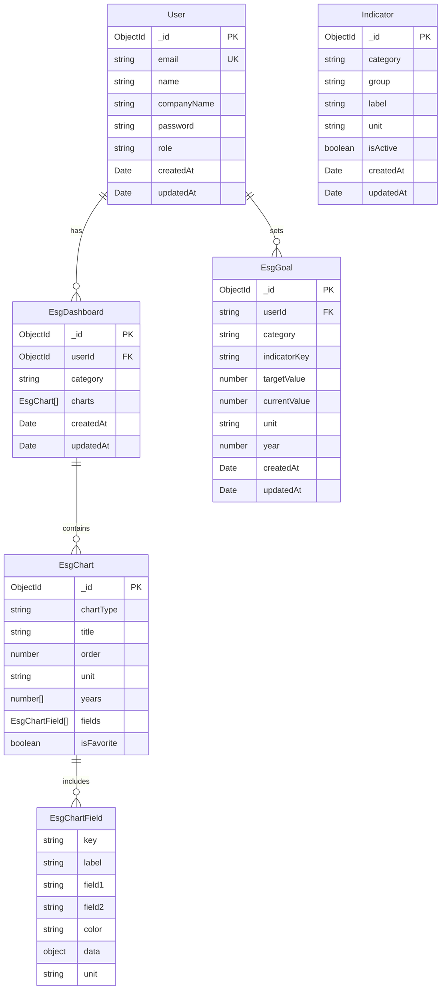
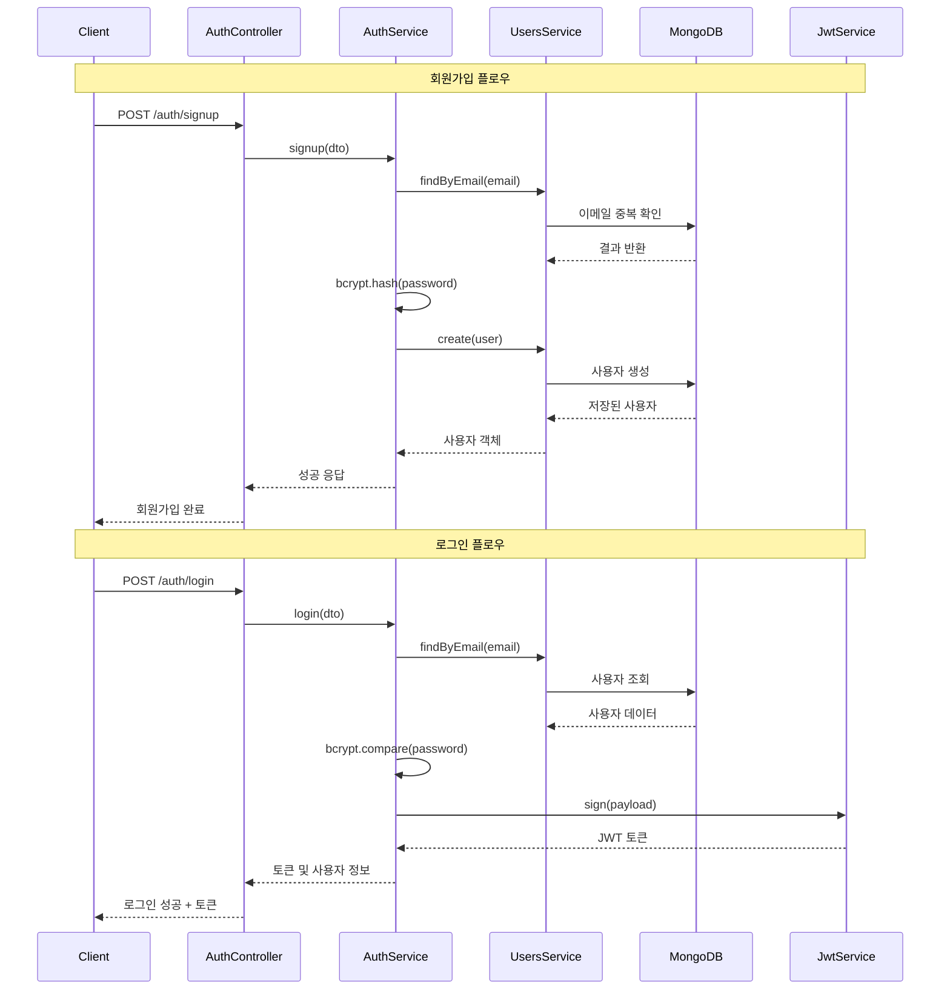
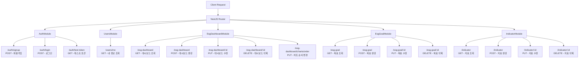
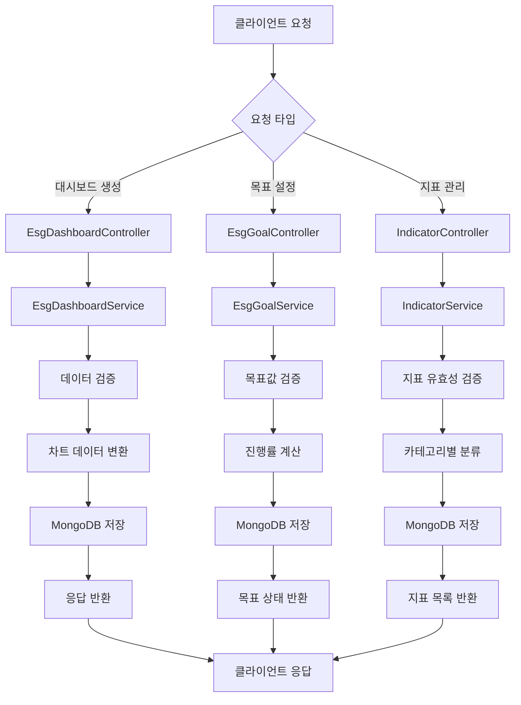

# NNMM - ESG 분석 및 통합 대시보드

Next.js, Nest.js, MongoDB, Mongoose를 기반으로 한 ESG 데이터 시각화 및 관리 플랫폼입니다.

---

## 📘 프로젝트 개요

- **프로젝트 명**: NNMM (Next.js + Nest.js + MongoDB + Mongoose)
- **개발 기간**: 2025.03.24 ~ 2025.04.07
- **팀원 및 역할**:
  - 김동환: Backend, Frontend, Design
  - 김지현: Backend, Frontend, Design
  - 정상진: Backend, Frontend, Design

---

## ✨ 프로젝트 요약문

NNMM은 ESG(Environmental, Social, Governance) 데이터를 통합적으로 수집·관리하고, 이를 시각화하여 한눈에 파악할 수 있도록 지원하는 ESG 분석 대시보드 플랫폼입니다.  
Next.js, NestJS, MongoDB, Mongoose 기반으로 구현된 본 시스템은 사용자 맞춤형 차트 설정, 목표 지표 관리, 자동 시각화 추천 기능 등을 통해 기업의 ESG 경영 활동을 디지털화하고 데이터 기반의 의사결정을 지원합니다.  
유연한 데이터 구조와 직관적인 UI를 통해 ESG 정보를 쉽게 기록하고 추적할 수 있으며, 모든 변경 내역은 이력으로 관리되어 투명하고 신뢰성 있는 ESG 관리 환경을 제공합니다.

---

## 🎯 프로젝트 목적

- ESG 데이터의 디지털화 및 시각화
- 유연하고 확장 가능한 ESG 관리 시스템 구축
- 지표 기반 목표 설정 및 성과 추적 기능 제공
- 자동화된 차트 생성 및 추천 기능 도입

---

## 🌟 기대 효과

- ESG 경영 활성화 지원
- 데이터 기반 의사결정 강화
- 사용자 맞춤형 대시보드 경험 제공
- 장기적으로 기업의 지속가능성 제고

---

## 🛠 사용 기술 스택

- **Frontend**: Next.js, TypeScript, TailwindCSS
- **Backend**: NestJS, TypeScript
- **Database**: MongoDB, Mongoose
- **시각화**: Chart.js, Recharts 등

---

## 🔧 주요 기능

- ESG 데이터(환경, 사회, 지배구조) 입력 및 관리
- 통합 대시보드에서 차트 생성 및 커스터마이징
- 지표별 목표 설정 기능
- 데이터 변경 이력 추적 (Audit Log)
- 차트 자동 생성 및 추천 기능

---

## 🔄 백엔드 아키텍처 및 시스템 다이어그램

### 1. NestJS 모듈 아키텍처

NestJS 기반의 모듈형 아키텍처 구조입니다.

```mermaid
graph TD
    A[AppModule] --> B[ConfigModule]
    A --> C[AuthModule]
    A --> D[UsersModule]
    A --> E[DatabaseModule]
    A --> F[IndicatorModule]
    A --> G[EsgDashboardModule]
    A --> H[EsgGoalModule]

    C --> I[AuthController]
    C --> J[AuthService]
    C --> K[JwtGuard]
    C --> L[JwtStrategy]

    D --> M[UsersController]
    D --> N[UsersService]
    D --> O[UserSchema]

    F --> P[IndicatorController]
    F --> Q[IndicatorService]
    F --> R[IndicatorSchema]

    G --> S[EsgDashboardController]
    G --> T[EsgDashboardService]
    G --> U[EsgDashboardSchema]

    H --> V[EsgGoalController]
    H --> W[EsgGoalService]
    H --> X[EsgGoalSchema]

    E --> Y[MongoDB Connection]
```

### 2. MongoDB 컬렉션 ERD

MongoDB 기반의 컬렉션 및 필드 구조를 표현한 ERD입니다.

### 3. JWT 인증 플로우 (백엔드)

백엔드에서의 JWT 기반 인증 및 인가 처리 흐름입니다.

### 4. API 엔드포인트 구조

RESTful API 엔드포인트 구조와 각 모듈의 역할입니다.

#### API 엔드포인트 상세 정보

| 모듈              | 엔드포인트                    | 메소드 | 설명                      | 인증 필요 |
| ----------------- | ----------------------------- | ------ | ------------------------- | --------- |
| **Auth**          | `/auth/signup`                | POST   | 회원가입                  | ❌        |
|                   | `/auth/login`                 | POST   | 로그인                    | ❌        |
|                   | `/auth/test-token`            | GET    | 테스트 토큰 발급          | ❌        |
| **Users**         | `/users/me`                   | GET    | 현재 사용자 정보 조회     | ✅        |
| **ESG Dashboard** | `/esg-dashboard`              | GET    | 사용자 대시보드 목록 조회 | ✅        |
|                   | `/esg-dashboard`              | POST   | 새 대시보드 생성          | ✅        |
|                   | `/esg-dashboard/:id`          | PUT    | 대시보드 수정             | ✅        |
|                   | `/esg-dashboard/:id`          | DELETE | 대시보드 삭제             | ✅        |
|                   | `/esg-dashboard/charts/order` | PUT    | 차트 순서 일괄 변경       | ✅        |
| **ESG Goal**      | `/esg-goal`                   | GET    | 사용자 목표 목록 조회     | ✅        |
|                   | `/esg-goal`                   | POST   | 새 목표 설정              | ✅        |
|                   | `/esg-goal/:id`               | PUT    | 목표 수정                 | ✅        |
|                   | `/esg-goal/:id`               | DELETE | 목표 삭제                 | ✅        |
| **Indicator**     | `/indicator`                  | GET    | ESG 지표 목록 조회        | ✅        |
|                   | `/indicator`                  | POST   | 새 지표 생성              | ✅        |
|                   | `/indicator/:id`              | PUT    | 지표 수정                 | ✅        |
|                   | `/indicator/:id`              | DELETE | 지표 삭제                 | ✅        |

### 5. ESG 데이터 처리 플로우

ESG 대시보드 데이터 생성 및 관리 처리 흐름입니다.

---
